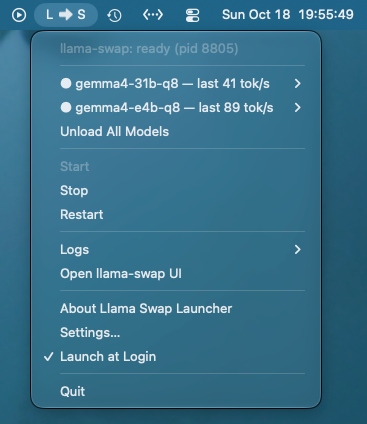
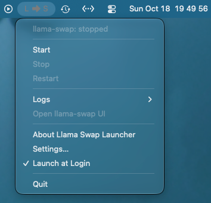
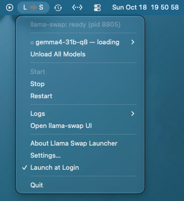
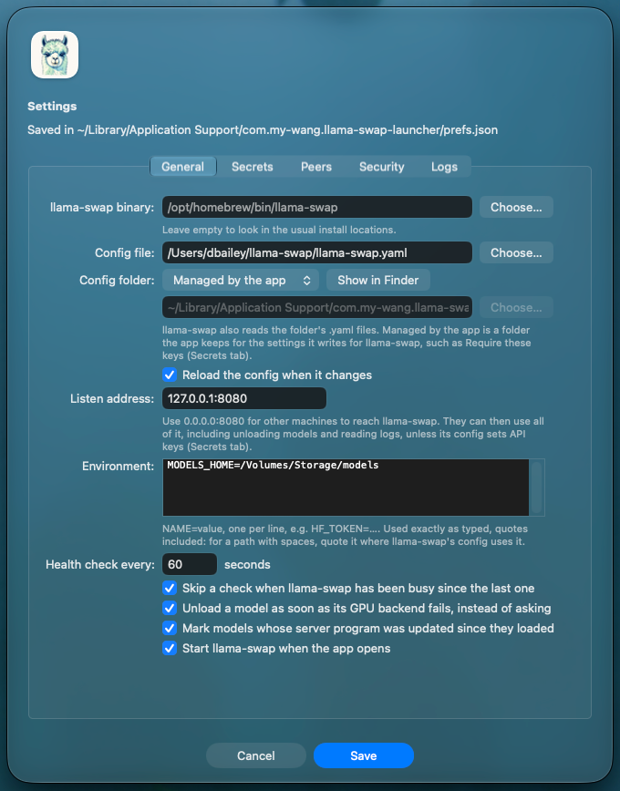
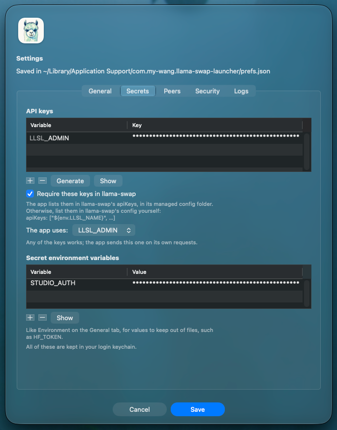
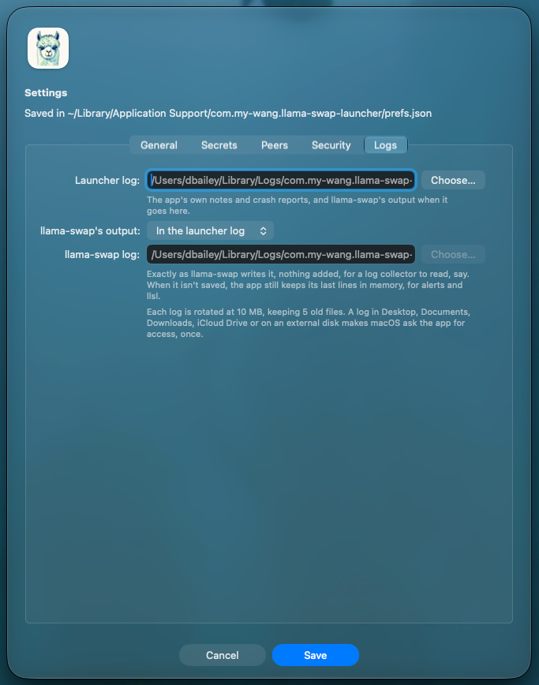
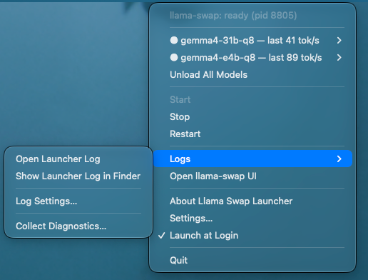

# Llama Swap Launcher

A macOS menu-bar app that runs, supervises and monitors
[llama-swap](https://github.com/mostlygeek/llama-swap), with a command-line
tool, `llsl`, for scripts and AI agents.

It exists because of macOS's **Local Network privacy** (macOS 15 and later):
a process can only connect to other machines on your LAN if the app
responsible for it has been given permission. Started from a plain Terminal
window, llama-swap works. Started from tmux, a script or a background job,
its LAN connections fail with "no route to host": peers, remote upstreams,
anything on the LAN. This app is llama-swap's parent, so the permission
belongs to the app. It's signed and notarized, so the permission survives
updates, and it works however you asked it to start llama-swap.

The app doesn't include llama-swap; install that separately.



## Requirements

- macOS 15 or later, Apple Silicon.
- llama-swap v252 or later (tested with v265), and whatever its config runs
  (such as llama.cpp's `llama-server`). With Homebrew, as
  [llama-swap's README](https://github.com/mostlygeek/llama-swap/blob/main/README.md)
  describes:

  ```sh
  brew tap mostlygeek/llama-swap
  brew install llama-swap
  ```

## Installing

1. Download `Llama-Swap-Launcher-<version>.zip` from
   [Releases](https://github.com/alron/llama-swap-mac-launcher/releases)
   (what changed is in [CHANGELOG.md](CHANGELOG.md)), unzip it, and move
   **Llama Swap Launcher** to `/Applications`. Open it.
2. The first time, it asks for your llama-swap config: open **Settings…**,
   choose the config file, and **Save**, then **Start**. It finds llama-swap
   itself in `/opt/homebrew/bin`, `/opt/homebrew/sbin`, `/usr/local/bin` or
   `~/go/bin`; if yours is elsewhere, set it in Settings too.
3. The first time llama-swap connects to something on your LAN, macOS asks
   whether **Llama Swap Launcher** may find and connect to devices on your
   local network. Allow it. (A third-party firewall such as Little Snitch
   asks separately.)
4. Put `llsl` on your `PATH`:

   ```sh
   ln -s "/Applications/Llama Swap Launcher.app/Contents/Helpers/llsl" /opt/homebrew/bin/llsl
   ```

   `llsl` follows the symlink to find the app it belongs to.

## The menu

- **Status:** starting, ready, not responding, running (but refusing the
  app; the line below says why, such as a missing API key), stopping,
  restarting (after a crash), stopped or failed, with llama-swap's pid.
- **Last GPU fault**, once a model's GPU backend has failed since the app
  started: which model, when, and whether it was unloaded automatically. A
  fault otherwise brings an alert offering to unload the model, or, with the
  `unloadOnGpuFault` preference, the app unloads it without asking.
- **Models:** the models loaded on this Mac, each with an **Unload** submenu,
  plus **Unload All Models**. Once a model has answered a request, the
  average generation speed of its latest one shows beside it ("last 119
  tok/s"; not a live reading). A model that's much slower than usual may
  have fallen back to the CPU. With the `markUpdatedModels` preference, a
  model whose server program was updated since it loaded (by `brew
  upgrade`, say) shows "outdated build, unload to update".
- **Start**, **Stop**, **Restart**.
- **Logs:** open the launcher log in Console, or show it in the Finder
  (drag it into a terminal for its path); the same for llama-swap's log while
  its output has a file of its own; **Log Settings…**, which opens
  Settings on its Logs tab (see [Logs](#logs)); and **Collect
  Diagnostics…** (see [Reporting a problem](#reporting-a-problem)).
- **Open llama-swap UI**.
- **About Llama Swap Launcher** (the app's version and build date, and
  llama-swap's version while it runs), **Settings…**, **Launch at Login**,
  **Quit** (which stops llama-swap).

In the menu bar, the app shows **L→S**, and the arrow's colour is the status:

- **the same colour as the letters:** llama-swap is working;
- **grey:** something is in progress: llama-swap starting, stopping or
  restarting, or a model loading or unloading;
- **red:** something needs attention: llama-swap failed or isn't responding,
  or a model's GPU backend has failed.

When llama-swap is stopped, the whole **L→S** is faded.

<p>
  
  
</p>

## `llsl`

```
llsl status                                  llama-swap's state, loaded models and peers
llsl start   [-wait] [-load MODEL] [-timeout D]
llsl restart [-wait] [-load MODEL] [-timeout D] [-force]
llsl stop    [-force]                        stop llama-swap and everything it started
llsl unload  MODEL | -all [-force]           unload one model, or all of them
llsl logs    [-n N] [-f] [-launcher]         the end of llama-swap's log, or follow it
```

`llsl` never starts llama-swap itself. It asks the app to. If the app isn't
running, `start` and `restart` launch it first, the way the Finder would, so
the app, and not your terminal, owns llama-swap and its LAN access. The other
commands never launch the app.

### Flags

| Flag | Meaning |
|---|---|
| `-wait` | Return once llama-swap is ready (answering requests), or has failed. |
| `-load MODEL` | Also load `MODEL` and wait until llama-swap reports it ready, or it has failed. Implies `-wait`. `MODEL` is a model ID from your llama-swap config, and one of this Mac's: a peer loads its own models when a request needs them, so a peer's model (`peer/model`) is refused, like a name that isn't in the config (exit 2). |
| `-timeout D` | How long `-wait` and `-load` may take, e.g. `90s`, `5m`. Default `10m`, since big models can take minutes to load. |
| `-json` | Print the result as JSON (`status`, `start`, `restart`, `stop`, `unload`). |
| `-all` | With `unload`: every model. |
| `-force` | With `restart`, `stop` and `unload`: go ahead even while llama-swap is serving requests, cutting them off. Without it they refuse (exit 7). |
| `-n N` | With `logs`: how many lines. Default 50. |
| `-f` | With `logs`: keep following the log, across rotations. |
| `-launcher` | With `logs`: the launcher log instead of llama-swap's output. |

Flags can be written with one dash or two.

### What each command does

- **`status`** prints the app, llama-swap's state, pid, listen address and
  version, the config and binary, the loaded models, its peers, and the log
  file. A model whose GPU backend has failed shows as `GPU BACKEND FAILED`.
  Each peer (another llama-swap in the config's `peers:`) is checked through
  llama-swap, the way requests reach it, and shows as `ok` or why not, such
  as `connection refused`. "No route to host" usually means macOS is
  blocking the app's local network access. A peer doesn't affect the exit
  code, and one that's off takes up to 3 seconds to give up on.
- **`start`** starts llama-swap unless it's already running. With `-wait` or
  `-load`, it still waits either way.
- **`restart`** first checks the config with `llama-swap -validate`. If the
  config is invalid, it reports why, exits 4, and leaves the running
  llama-swap exactly as it was. Otherwise it stops llama-swap and everything
  it started, then starts it again. If llama-swap wasn't running, it just
  starts it.
- **`stop`** stops llama-swap and all its model servers. If the app isn't
  running, there's nothing to stop, and it exits 0.
- **`unload`** unloads a model. llama-swap loads it again, in a new process,
  on the next request for it.
- **While llama-swap is serving requests,** `restart` and `stop` refuse, and
  so does `unload` if one of the requests is for that model (`-all`: for any
  of this Mac's models). They say what's in flight, such as "1 request
  (gemma4-31b-q8 for 1m12s)", do nothing, and exit 7, so one script or agent
  doesn't cut off another's work. `-force` goes ahead anyway; llama-swap then
  waits for its requests for up to 15 seconds before the app stops it and
  everything it started. If the app can't see llama-swap (it isn't
  answering, say), they go ahead, so a stuck llama-swap can always be
  stopped. The menu's Stop and Restart never ask.
- **`logs`** prints the end of the file llama-swap's output goes to (see
  [Logs](#logs)), or with `-launcher` the launcher log. It reads the file
  directly, so it works even when the app isn't running. When llama-swap's
  output isn't saved, it prints the last lines the app keeps in memory
  instead (up to 100), and `-f` has nothing to follow.

On failure, `llsl` prints the reason on stderr. For exit codes 1, 5 and 6 it
also prints llama-swap's last lines of output (up to 20), which the app keeps
in memory whatever the log settings.

`llsl` comes inside the app, and if the running app is a different version,
it says so on stderr: that happens after an update while the old app is still
running, so quit the app and open it again. An app from 0.1.2 or earlier
can't be reached at all by a newer `llsl`; it says that too, and exits 3.

### Exit codes

| Code | Meaning |
|---|---|
| 0 | OK. For `status`: llama-swap is ready and no model's GPU backend has failed. |
| 1 | Failed: llama-swap couldn't start, or exited. For `status`: it isn't ready, or a model's GPU backend has failed. |
| 2 | Usage error, including `-load` naming a peer's model or one that isn't in the config. |
| 3 | The app isn't running (`status`, `unload`), or couldn't be launched (`start`, `restart`). |
| 4 | The config isn't valid. llama-swap was left as it was. |
| 5 | The model given to `-load` didn't load. |
| 6 | Timed out. |
| 7 | Busy: llama-swap is serving requests, so `restart`, `stop` or `unload` did nothing. See `-force`. |

### JSON output

```json
{
  "ok": true,
  "status": {
    "appPid": 31539,
    "appVersion": "0.3.0",
    "bundleID": "com.my-wang.llama-swap-launcher",
    "state": "ready",
    "pid": 31590,
    "listen": "127.0.0.1:8080",
    "version": "v265 (d1e743f)",
    "binary": "/opt/homebrew/bin/llama-swap",
    "config": "/path/to/llama-swap.yaml",
    "configDir": "/Users/you/Library/Application Support/com.my-wang.llama-swap-launcher/llama-swap.d",
    "managedConfig": true,
    "apiKeysRequired": true,
    "logFile": "/Users/you/Library/Logs/com.my-wang.llama-swap-launcher/launcher.log",
    "launcherLog": "/Users/you/Library/Logs/com.my-wang.llama-swap-launcher/launcher.log",
    "models": [
      { "id": "qwen3.5-9b-q8", "state": "ready", "lastTokensPerSecond": 118.7 },
      { "id": "gemma4-31b-q8", "state": "ready", "faulted": true }
    ],
    "peers": [
      { "id": "studio", "ok": true },
      { "id": "laptop", "ok": false, "error": "HTTP 502: peer proxy error: dial tcp 192.168.1.20:8080: connect: connection refused" }
    ]
  }
}
```

- `state` is one of `stopped`, `starting`, `ready`, `not responding`,
  `running`, `stopping`, `restarting` or `failed`. `running` means
  llama-swap runs but refuses the app, so the app can't see its models or
  health: usually an API key the app doesn't have (see
  [API keys](#api-keys)). A `message` field explains the failure, or the
  refusal, when there is one. `start -wait` and `restart -wait` fail (exit 1)
  with that message rather than wait.
- `version` is the running llama-swap's, as `llama-swap -version` reports
  it; `appVersion` is the app's.
- `warning`, when llama-swap can be used without an API key and it
  matters: the app has keys that llama-swap's config doesn't list, or it
  listens beyond this Mac with none. It doesn't change the exit code.
- `configDir` is the config folder llama-swap reads, if any.
  `managedConfig` means it's the app's own, and `apiKeysRequired` that the
  app lists its API keys there for llama-swap to require (see
  [Config folder](#config-folder)).
- `logFile` is where llama-swap's output goes (`""` when it isn't saved), and
  `launcherLog` the app's own log; they're the same file by default.
- A failure's reply has `output`: llama-swap's last lines (up to 20).
- Model states are llama-swap's: `starting` (loading), `ready`, `stopping`
  (unloading). Only models loaded on this Mac are listed; peers' models
  aren't. `faulted` means the model's GPU backend has failed.
  `lastTokensPerSecond` is the model's average generation speed in its
  latest request since it loaded (not a live reading), once it has
  generated something. `updated` (with the `markUpdatedModels` preference)
  means its server program has changed on disk since it loaded; unloading
  it makes the next request start the new build.
- `peers` comes only from `status`, while llama-swap is ready: each peer,
  whether it answered, and if not, why.
- `lastGpuFault`, once a model's GPU backend has failed since the app
  started: `model`, `at`, and `autoUnloaded` if the `unloadOnGpuFault`
  preference unloaded it. It stays after the model is unloaded, when
  `faulted` has cleared, so a script can see that a fault happened.
- On failure, `ok` is `false`, and `code` and `error` say why. `code` is one
  of `usage`, `invalid_config`, `start_failed`, `load_failed`, `timeout`,
  `busy` or `error`, or `not_running` from `status` when the app isn't
  running.

### For scripts and AI agents

**Read [Security](#security) first.** An agent allowed to edit llama-swap's
config and run `llsl restart` can run any command on this Mac, outside
whatever sandbox the agent itself runs in, because the app runs what the
config says.

- **Don't start llama-swap directly** (`llama-swap -config …`) from tmux, a
  script or an agent. It would run without the app's Local Network
  permission, and its LAN connections would fail. Use `llsl`.
- **Make sure it's up:** `llsl start -wait`.
- **After editing llama-swap's config:** `llsl restart -wait`. Exit 4 means
  the config is invalid; the reason is on stderr, and the previous llama-swap
  is still running. Exit 1 means the new one didn't come up; check the log
  lines printed with it.
- **Check that a model actually works:** `llsl start -load MODEL`, which
  exits 5 if it doesn't load. llama-swap loads models on demand, so a
  successful restart alone doesn't prove every model's command line is right.
- **Health check:** `llsl status` exits 0 only when llama-swap is ready and
  no model's GPU backend has failed. Use `llsl status -json` to see which.
- **A model's GPU backend failed** (after a Metal error, its requests return
  HTTP 500 while llama-swap itself looks healthy): `llsl unload MODEL`. The
  next request loads it again in a fresh process. For long unattended runs,
  the `unloadOnGpuFault` preference does that automatically, and
  `lastGpuFault` in `llsl status -json` records it.
- **Logs:** `llsl logs -n 100`, or `llsl logs -f` in another terminal.
- **Free the GPU memory:** `llsl unload -all` unloads the models and keeps
  llama-swap running; `llsl stop` stops everything.

## Settings

**Settings…** in the menu edits them, and saves them as preferences. The **General** tab has the
llama-swap binary and config (each with a **Choose…** button), the config
folder (see [Config folder](#config-folder)), the listen address,
environment variables (one per line), and the settings below; the **Secrets** tab has llama-swap's API keys and secret
environment variables, the **Peers** tab the peers the app manages (see
[Peers](#peers)), the **Security** tab which web pages may use llama-swap
(see [Web pages](#web-pages)), and the **Logs** tab where the logs go (see
below). Save checks
them first: if something's wrong, an alert says what, and the dialog comes back
with your entries and the problem shown until it's fixed. If llama-swap is
running when you save a change it runs with, the app offers to restart it.
Health-check changes take effect straight away. While the dialog is open, the
menu offers only **Quit**.



They're stored in
`~/Library/Application Support/com.my-wang.llama-swap-launcher/prefs.json`,
which you (or a script) can also edit by hand in any text editor. The file is
reread whenever llama-swap starts. A key it doesn't know, usually a
misspelling, is reported as an error rather than ignored.

| Key | Default | Meaning |
|---|---|---|
| `binary` | `""` | The llama-swap executable. Empty: look in the usual install locations. Like every path here, it may start with `~/`. |
| `config` | `""` | llama-swap's config file. |
| `listen` | `"127.0.0.1:8080"` | Passed to llama-swap as `-listen`. Use `"0.0.0.0:8080"` for other machines to reach it; they can then use all of it, including unloading models and reading logs, unless its config sets API keys (see [API keys](#api-keys)). |
| `watchConfig` | `false` | Pass `-watch-config`, so llama-swap reloads its config when the file, or the config folder, changes. It checks every 2 seconds. |
| `configDirMode` | `"off"` | Whether llama-swap also reads a folder of config files (`-config-dir`): `"off"`, `"own"` (`configDir`) or `"managed"` (the app's own folder). See [Config folder](#config-folder). |
| `configDir` | `""` | Your own config folder, with `"own"`. The app never writes there. |
| `manageApiKeys` | `false` | With the managed folder, list the API keys in llama-swap's `apiKeys` for it, so it requires them. See [API keys](#api-keys). |
| `peers` | `[]` | The peers the app manages, each with `name`, `url`, `keyVariable` (a secret variable, or `""`), `models`, and optionally `timeouts` (`responseHeader`, `connect`, `keepalive`, in seconds, as llama-swap names them). Used with the managed folder; see [Peers](#peers). |
| `cors` | off | Which web pages may use llama-swap: `restrict`, `allowedOrigins`, `allowCredentials`, `allowPrivateNetwork` and `maxAge`, as llama-swap's `security.cors` names them. Used with the managed folder; see [Web pages](#web-pages). |
| `args` | `[]` | Extra llama-swap arguments, for flags newer than the app. Settings doesn't show them. Not `-config`, `-listen`, `-config-dir` or `-watch-config`, which are settings above, nor the TLS flags, `-validate` or `-version`. A `-watch-config` here from an earlier version becomes `watchConfig` when the file is read. |
| `env` | `{}` | Environment variables for llama-swap and the commands its config runs, e.g. `{"HF_TOKEN": "…"}`. Values are used exactly as typed, quotes included; for a path with spaces, see [Good to know](#good-to-know). |
| `autoStart` | `true` | Start llama-swap when the app opens. |
| `healthCheckSeconds` | `60` | How often to check that llama-swap still answers. |
| `healthCheckSkipWhenActive` | `true` | Skip a check when llama-swap has been busy since the last one. |
| `markUpdatedModels` | `false` | Mark a loaded model whose server program (such as `llama-server`) has changed on disk since it loaded, after `brew upgrade llama.cpp`, say: it runs the old build until it's unloaded. Checked every minute. |
| `unloadOnGpuFault` | `false` | Unload a model as soon as its GPU backend fails, instead of asking. For runs nobody is watching: every request to such a model fails until it's unloaded. |
| `launcherLog` | `""` | The launcher log. Empty: `launcher.log` in the app's log folder. |
| `llamaSwapLog` | `"launcher"` | Where llama-swap's output goes: `"launcher"` (into the launcher log), `"file"` (its own file) or `"off"` (not saved). |
| `llamaSwapLogFile` | `""` | llama-swap's own log, with `"file"`. Empty: `llama-swap.log` in the app's log folder. |
| `apiKeys` | `[]` | The names of llama-swap's API keys, without `LLSL_`. The keys themselves are in the keychain; see below. |
| `appApiKey` | `""` | Which of them the app uses for its own requests. Empty: the first. |
| `secretEnv` | `[]` | The names of secret environment variables. Their values are in the keychain; see below. |

**llama-swap doesn't inherit your shell's environment.** It gets `HOME`,
`USER`, `LOGNAME`, `SHELL` and `TMPDIR`, a `PATH` made of llama-swap's own
folder, the install locations above, and the system folders, and then the
`env` preference. A config that runs `llama-server` by bare name finds it
through that `PATH`. Anything else your config relies on from your shell
belongs in `env`. llama-swap runs in the config file's folder, so relative
paths in the config work.

### Config folder

Besides its config file, llama-swap can read a folder of config files, and
**Config folder** on the General tab chooses one:

- **None:** just the config file.
- **Your own folder:** a folder you choose, for splitting your config into
  several files. The app never writes there.
- **Managed by the app:** the app's own folder,
  `~/Library/Application Support/com.my-wang.llama-swap-launcher/llama-swap.d/`.
  The app writes the settings it manages for llama-swap there, each time it
  starts llama-swap, such as **Require these keys in llama-swap** (see
  [API keys](#api-keys)). **Show in Finder** opens it. Files of your own
  there are read too, and left alone; the app won't overwrite a file with
  one of its names that it didn't write.

How llama-swap combines them: the config file first, then the folder's
`.yaml` and `.yml` files (not those in subfolders), in name order.

- **Lists add up.** An `apiKeys` list in the config and another in the
  folder: either file's keys work.
- **Sections merge**, key by key.
- **A single value set differently in two files is an error.** So is the
  same model, group, peer or profile ID in two files. llama-swap names the
  file, and Start and Restart report it, leaving the running llama-swap as
  it was.
- **Names must match exactly.** llama-swap ignores a key it doesn't know,
  silently: `apikeys:` in lower case does nothing.

With **Reload the config when it changes**, llama-swap rereads the folder
too.

### Peers

A peer is another llama-swap, on this network or elsewhere, or any server
with the same API (OpenRouter, say), whose models llama-swap offers as
`name/model`. The **Peers** tab manages them for you, with **Config folder**
set to **Managed by the app**:

1. Click **+**, and give the peer a name (letters, digits, dots, dashes and
   underscores) and its URL, such as `http://192.168.1.20:8080`.
2. If it needs a key, add the key under **Secrets → Secret environment
   variables**, and choose that variable as the peer's **Key**.
3. **Fetch Models** asks the peer what it serves, with the key, and lists
   it. Tick the models llama-swap should offer. **Filter** narrows a long
   list, and **Tick All Shown** and **Untick All Shown** act on what it
   shows. Fetching again adds new models unticked and keeps your ticks. For
   a model the peer doesn't list, type its name and click **Add**.
4. If the peer is slow to start answering (slower hardware, or long prompts
   at a large context), raise **Wait for a reply** above llama-swap's 60
   seconds. **Connect** and **Keep-alive** are there too. They start at
   llama-swap's defaults; 0 means no limit, which llama-swap advises
   against. Only values you change are written.
5. Save, and let the app restart llama-swap.

The app writes them to `peers.yaml` in its config folder each time it
starts llama-swap; the key goes in as `${env.NAME}`, never the key itself.
llama-swap sends that key to the peer with every request, so choose a
variable meant for that peer. With an `http://` URL, the key crosses the
network unencrypted, as llama-swap's own keys do (see [Security](#security)).
A user name or password in the URL is refused: put the key under Secrets
instead. Fetch Models doesn't follow a redirect, since it would carry the
key elsewhere; give the address the peer redirects to.
Another llama-swap also lists its own peers' models; Fetch Models leaves
those out.

**Keep each peer in one place.** llama-swap refuses to load when its config
and the app's folder both define a peer of the same name, and Start and
Restart say so. To move a peer from your config into the app, delete it
from the config and add it on the Peers tab. A peer that needs llama-swap's
`filters`, its other timeouts (`tlsHandshake`, `expectContinue`,
`idleConn`) or a `tailcat://` address stays in your config for now.

### Web pages

By default llama-swap lets any web page use it, including pages open in
your browser right now. The **Security** tab, with **Config folder** set to
**Managed by the app**, limits that:

- **Only let these web pages use llama-swap:** the pages allowed, one per
  line, as the browser shows them: `http://localhost:3000`, with no path and
  no trailing slash. A front end such as Open WebUI goes here. llama-swap's
  own UI doesn't need to: it's the same site.
- **Let them send cookies and Authorization headers:** for a page that logs
  in to llama-swap with a key from the browser.
- **Let them reach llama-swap on this network from a public site:** Chrome
  asks before a page on a public site uses a server on your network
  (Private Network Access), and llama-swap answers yes only with this.
- **Browsers may cache a check for:** how long a browser may remember
  llama-swap's answer before asking again. It starts at llama-swap's 86400
  seconds; only a changed value is written.

The last three apply only while the first is ticked, as llama-swap requires.

**This isn't a lock.** A page that isn't listed can't read llama-swap's
replies, or send it JSON, but it can still send a simple request, such as
an unload. API keys stop that; see [API keys](#api-keys). One exception: a
browser that's logged in to llama-swap's UI may send that login along with
another page's request, so on a Mac where the UI is used from a browser,
keys don't fully protect against pages open in that same browser.

The app writes this to `security.yaml` in its config folder. Pages your own
config lists in `security.cors.allowedOrigins` are allowed too, but a switch
or cache time your config sets to a different value stops llama-swap from
loading, and Start and Restart say so. Set each in one place.

### API keys

Without `apiKeys` in its config, llama-swap answers anyone who can reach it:
they can use its models, unload them, and read its logs. If it listens
beyond this Mac (`0.0.0.0`, or a LAN address), that's anyone on your network,
and on any network the Mac joins later. Even on `127.0.0.1` it's more than
you might think: llama-swap allows requests from any web page by default
(`Access-Control-Allow-Origin: *`), so a page open in your browser can use
it too, as can other users of this Mac; see [Web pages](#web-pages) to
narrow that. The app keeps those keys in your login keychain rather than in a
file, and hands them to llama-swap as environment variables, so your config
names a variable instead of holding the key:

```yaml
apiKeys:
  - "${env.LLSL_ADMIN}"
  - "${env.LLSL_CLAUDE}"
```

**Or let the app list them.** With **Config folder** set to **Managed by the
app** on the General tab, tick **Require these keys in llama-swap** on the
Secrets tab. The app then writes that list into its config folder each time
it starts llama-swap, so your config needs no `apiKeys` at all. Keys your
own config lists keep working alongside them.



1. In **Settings… → Secrets**, under API keys, click **+** for each key. It gets a new
   random key; name it to match the config (`ADMIN` for `LLSL_ADMIN`), or
   paste a key you already use. **Generate** makes a new random key for the
   selected one.
2. To give a key to a client, select it and click **Show**, then select it
   and copy it with ⌘C.
3. Save, and let the app restart llama-swap.

- Every key's variable starts with `LLSL_`, so a key can't replace another
  variable llama-swap needs. The `env` preference can't use the prefix.
- Any key works for the app's own requests; **The app uses** picks which.
- A variable the config names but the app has no key for stops llama-swap
  from starting: Start and Restart report
  `environment variable 'LLSL_…' is not set` and leave the running
  llama-swap as it was.
- With keys set, **Open llama-swap UI** gets a login prompt from your
  browser: any user name, and one of the keys as the password.
- **The app checks.** Once llama-swap is ready, it asks it, without a key,
  for something that needs one. If llama-swap answers, the menu and
  `llsl status` (`warning`) say so when it matters: the app has keys that
  llama-swap's config doesn't list (so it ignores them), or llama-swap
  listens beyond this Mac with no key at all. Saving settings that would
  open it to the network without a key asks first, and so does turning off
  the managed keys while other machines can reach it.
- `llsl` never needs a key: it asks the app, which sends one.
- The keychain keeps each key encrypted on disk, and other programs can only
  read it with your permission. While llama-swap runs, the keys are in its
  environment, where your own programs could read them.

### Secret environment variables

A variable whose value shouldn't sit in a file, such as `HF_TOKEN`, goes in
**Settings… → Secrets → Secret environment variables** instead of
**Environment** on the General tab. llama-swap and the commands its config
runs get it the same way, but its value is kept in your login keychain, and
`prefs.json` holds only its name. **Show** reveals a value; a variable can't
be both plain and secret, and names starting with `LLSL_` are kept for API
keys.

### Logs

The **launcher log** has the app's own notes (lines marked `[launcher]`:
each start of llama-swap with its version, crashes, what `llsl` asked for,
and a note when llama-swap is newer than the version the app was tested
with) and its crash reports. llama-swap's output goes, as **Settings… →
Logs** says:

- **In the launcher log** (the default), among the app's notes.
- **In its own file**, exactly as llama-swap writes it, with nothing added:
  for a log collector (Splunk, Elastic) to read, especially once llama-swap
  writes structured lines.
- **Not saved.** The app still keeps its last 100 lines in memory, for the
  failure alert, `llsl logs` and the output `llsl` prints on a failure.



The app's own `/health` checks and `llsl status`'s peer checks are left out
of llama-swap's output. Each log is rotated at 10 MB, keeping 5 old files.
Changes apply when you save, or, for hand edits of `prefs.json`, at
llama-swap's next start. A log in Desktop, Documents, Downloads, iCloud Drive
or on an external disk makes macOS ask the app for access, once; at login
nobody may be there to answer, so the app's own log folder is the safe
choice. If a log can't be opened, the app says so and keeps writing where it
was.

Up to version 0.1.2, the launcher log was called `llama-swap.log`; later
versions call it `launcher.log`, and an old `llama-swap.log` simply stops
growing.

## Files

| What | Where |
|---|---|
| The launcher log | `~/Library/Logs/com.my-wang.llama-swap-launcher/launcher.log` by default; see [Logs](#logs). |
| llama-swap's own log | `~/Library/Logs/com.my-wang.llama-swap-launcher/llama-swap.log` by default, when its output has a file of its own. |
| Preferences, control socket, pidfile | `~/Library/Application Support/com.my-wang.llama-swap-launcher/` |
| API keys and secret variables | Your login keychain, as "Llama Swap Launcher: llama-swap API key LLSL_…" and "Llama Swap Launcher: secret environment variable …" (Keychain Access can show and delete them). |

## Good to know

- **Local Network access denied?** Look in System Settings → Privacy &
  Security → Local Network, and turn on Llama Swap Launcher. The symptom is
  "no route to host" in llama-swap's log.
- **One llama-swap per address.** If something else is already listening on
  the listen address, such as a llama-swap you started some other way, or
  the other build of this app, the app refuses to start another and says
  what's holding it.
- **Crashes:** if llama-swap crashes, the app stops any model servers it left
  running (they'd otherwise keep their memory), then restarts it after 1, 2,
  4, 8 seconds. After five crashes within five minutes, it stops trying and
  tells you, with the last lines llama-swap wrote, which usually say why. If
  the app itself crashes, llama-swap usually stops with it, but its model
  servers don't; the next time the app opens, it stops them first.
- **A llama-swap downloaded with a browser** may be blocked by Gatekeeper the
  first time. The app explains how to allow it.
- **A path with spaces in a model's command** needs quotes in llama-swap's
  config, where the path is used. llama-swap puts `${env.NAME}` values and
  macros into a model's `cmd` as plain text, then splits the `cmd` into
  arguments the way a shell does, so `/Volumes/My Disk/models` becomes two
  arguments. With `MODELS_HOME` set to the plain path in Settings:

  ```yaml
  macros:
    models: "${env.MODELS_HOME}"
  models:
    my-model:
      cmd: llama-server --port ${PORT} --model '${models}/my-model.gguf'
  ```

  Quoting the value in Settings instead also works, but the quotes then
  become part of the variable, for anything else that reads it (llama-swap's
  model servers inherit it). Quote in one place only: with both, the quotes
  end up in the path.
- **Open the app, don't run its executable.** Use the Finder, `open`, or
  `llsl`. Running `…/Contents/MacOS/llama-swap-launcher` directly isn't
  supported.

## Reporting a problem



**Logs → Collect Diagnostics…** saves a zip, wherever you choose (the Desktop
is suggested), with what's needed to look into a problem:

- a summary: the app's and llama-swap's versions, macOS, the Mac's model,
  chip and memory, the state, and how the app is set up;
- the status, as `llsl status -json` gives it;
- the preferences, llama-swap's config, and the logs (each current file and
  the one before it);
- llama-swap's last 100 lines of output, from the app's memory.

Secrets are redacted first, in every file: the values of your API keys and
secret variables wherever they appear, keys and lists named like
credentials, `--api-key`-style flags, Authorization headers, variables named
like secrets, passwords in URLs, and anything shaped like a Hugging Face,
OpenAI, GitHub, Slack or AWS key. Your home folder becomes `~`, and your
user name, wherever else it appears, `<user>`. Still, look
the files over before you share them: no redaction can promise to catch
everything, the config has your hostnames and paths, and the logs can hold
prompts and replies. Nothing is ever
sent anywhere by the app.

## Security

To report a vulnerability, see [SECURITY.md](SECURITY.md).

What the app trusts, and what it doesn't protect against:

- **Its settings and llama-swap's config decide what it runs.** Anything
  running as your user can change either, and can reach `llsl`'s control
  socket, so it can make the app run any program: with the app's Local
  Network permission, with any file access macOS has granted the app, and
  with every API key and secret variable in its environment, without a
  keychain prompt. That's what a launcher is, as with a terminal; the app
  isn't a sandbox. Other users of the Mac can't: the socket and files are
  yours alone, and the app refuses other users' connections.
- **Agents:** for the same reason, an agent allowed to edit llama-swap's
  config and run `llsl restart` can run any command, outside whatever
  sandbox the agent runs in. Give an agent that only if you'd let it run
  commands. `llsl`'s output also carries text from elsewhere (request
  paths in log lines, a peer's error), which an agent reads as input.
- **The keychain protects keys at rest:** in files, backups and diagnostics
  they're never in plain text. While llama-swap runs, they're in its
  environment, where your own programs can read them.
- **No encryption on the network.** llama-swap speaks plain HTTP, so API
  keys and prompts cross the LAN unencrypted. llama-swap's TLS flags aren't
  supported under the app (its health monitor speaks HTTP), so on an
  untrusted network, keep llama-swap on `127.0.0.1`.
- **Keys matter even locally:** see [API keys](#api-keys) for what a
  llama-swap without them allows, on `127.0.0.1` too.

## Building from source

Needs Go 1.27 or later and Apple's Command Line Tools. Signing needs a
Developer ID Application certificate; notarizing needs a `notarytool`
keychain profile.

```sh
make test      # unit tests
make lint      # go vet and staticcheck
make sec       # gosec
make vuln      # govulncheck
make dev       # build/Llama Swap Launcher Dev.app: separate bundle ID, signed, not notarized
make run       # build and open the dev app
make release   # build/release/Llama-Swap-Launcher-<version>.zip: signed, notarized, stapled
```

GitHub Actions runs the tests, the checkers and an ad-hoc build for every
push and pull request, on macOS 15
([`.github/workflows/ci.yml`](.github/workflows/ci.yml), which also names
the checkers' versions). It holds no secrets: releases are signed,
notarized and published on the maintainer's Mac (`make release`, then `make
publish`), so the signing keys aren't on GitHub.

Override `SIGN_IDENTITY` (use `-` for an unsigned, ad-hoc build) and
`NOTARY_PROFILE` on the `make` command line. The dev app is a separate app,
**Llama Swap Launcher Dev**, with its own preferences, logs and Local Network
permission. Its `llsl` talks to it rather than to the release app.
`LLSL_BUNDLE_ID` overrides which app `llsl` talks to.

**Forks and ad-hoc builds should use their own bundle ID** (`make
BUNDLE_ID=com.example.llama-swap-launcher …`). Under this one, an ad-hoc
build gets a new identity each time, leaving Local Network entries in System
Settings that can't be removed, and shares this app's folders, control
socket and keychain items.

## How it was made

Llama Swap Launcher was built with generative AI, and this is how.

- **The code, tests and documentation were written by Claude**, Anthropic's
  AI model, working in Claude Code under the maintainer's direction. Commits
  say so with a `Co-Authored-By: Claude` line.
- **The maintainer** set the goal, made the design decisions, and signs and
  notarizes the releases with their own Developer ID, on their own Mac. Every feature was
  tested on real Macs before it was committed, by hand or by Claude driving
  the real app.
- **Checks and reviews:** unit tests, tests against a real llama-swap,
  `go vet`, `staticcheck`, `gosec` and `govulncheck`, also run by GitHub
  Actions for every push and pull request. On top of those, reviews of the
  project by local models (Gemma 4 and Qwen 3.6) and by a second Claude
  model, whose accepted suggestions are recorded in CLAUDE.md.
- **[CLAUDE.md](CLAUDE.md)** is the working brief the AI sessions follow:
  the goal, each decision and why, what was tried and found, and what's
  left. It stays in the repository, so how the project was built is open to
  read.

## License

MIT; see [LICENSE](LICENSE). Not affiliated with the llama-swap project; just
a fan of it.
